<p align="center">
  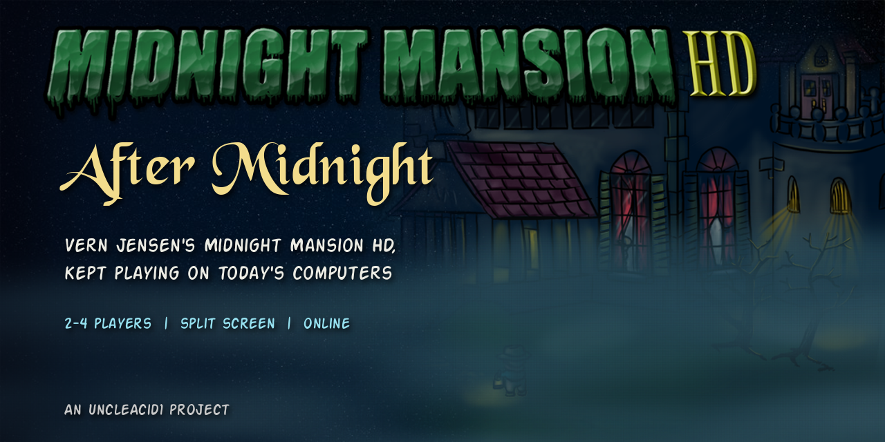
</p>

<h3 align="center">Vern Jensen's <i>Midnight Mansion HD</i>, kept playing on today's computers, and on the PS3.</h3>

<p align="center">
  
  
  
  
  
</p>

<p align="center">
  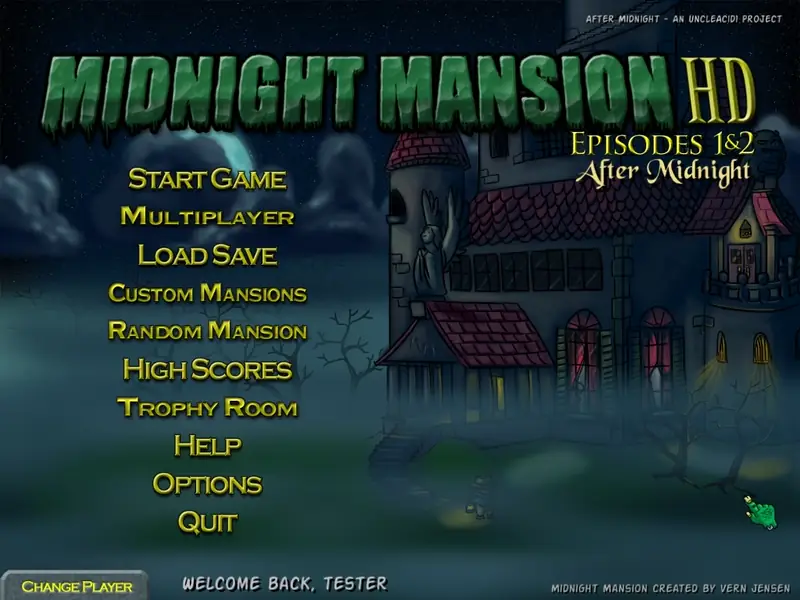
</p>

> **Midnight Mansion was created by Vern Jensen.**
> *Midnight Mansion HD – Episodes 1 & 2* (ActionSoft, 2011) is his game. *After Midnight* exists to keep it
> playing, on machines that didn't exist when he made it, and to open its doors so friends can
> explore it together. It's made with gratitude, and it's offered as a tribute.

---

## Contents

- [What is this?](#what-is-this)
- [What After Midnight adds](#what-after-midnight-adds)
- [Screenshots](#screenshots)
- [Getting started](#getting-started)
- [Controls](#controls)
- [Playing together](#playing-together)
- [The lobby server](#the-lobby-server)
- [How it was made](#how-it-was-made)
- [Project layout](#project-layout)
- [Credits](#credits)
- [Legal](#legal)

---

## What is this?

*Midnight Mansion HD* is a side-scrolling puzzle-platformer: Jack Malone, fearless adventurer,
works his way through haunted mansions full of levers, keys, secret passages, Medusas,
skeletons, spiders and zappers, on the trail of a treasure hidden deep in Spider Palace.
The 2011 Mac release no longer runs on modern Macs.

*After Midnight* is that game rebuilt from its original Mac release. Its C source was
reconstructed function by function and now runs natively on Apple Silicon and Intel Macs, on
Linux and on the PlayStation 3, using the original game's own art, sound, music and mansions. **With the new options
off, it plays exactly as the original did.** Turn them on and the house has some new rooms.

## What After Midnight adds

<table>
<tr>
<td width="50%" valign="top">

### 👥 Multiplayer for 2–4

- **Co-op**: take turns and share the lives. When the player whose turn it is dies, the
  next one comes in. Doors, keys and treasure are shared.
- **Arcade Split Screen**: everyone plays at once, each in their own view of one mansion.
  A lever one player pulls is pulled for everybody, and everyone in a room sees the same
  platforms and enemies. Every player has their own lives.
- **Ghost Race**: everyone gets their own copy of the mansion, and the others show as ghosts.
  Fastest out wins, and each life lost adds 15 seconds.
- On **one computer** (keyboards and controllers), across your **local network**, or **online**.

</td>
<td width="50%" valign="top">

### 🌐 Online

- **Public and private games** through a small lobby server. Nobody has to open ports on
  their router.
- **Friend codes**: every player profile has a unique ID. Add friends, see who's online, and
  join their private games.
- **Chat**: press **T** in any game on several computers. Every line is logged to
  `Chat Log.txt`.
- **Saves for the group**: a multiplayer save is filed under exactly who played it, and is
  only offered when the same people are together again.

</td>
</tr>
<tr>
<td valign="top">

### 🎮 Play your way

- **Controllers** everywhere: menus, play, and an on-screen keyboard for every text box.
  Includes rumble.
- **Fun options**: moon gravity, *Oops! All Spiders*, *Pitch Black*, *Jack on Espresso*,
  *Jack's Pinata Party*, *Nine-Lived Malone* and more.
- **Extras**: smooth sliding room transitions, a centred main menu, and the multiplayer
  smoke effect (on or off).

</td>
<td valign="top">

### 🏚️ More mansion

- **Trophy Room**: each player's lifetime stats, down to every Medusa and long fall.
- **89 community custom mansions** included, plus your own. A star marks the ones you've beaten.
- **Random Mansion**: roll the dice and see where you land.
- **Fixes**: the original's headings now show in Black Chancery as intended. A font-cache
  bug had been drawing every font in the game's folder as the first one loaded.

</td>
</tr>
</table>

Everything new is documented in detail in **[docs/EXTRAS.md](docs/EXTRAS.md)**.

## Screenshots

<table>
<tr>
<td align="center">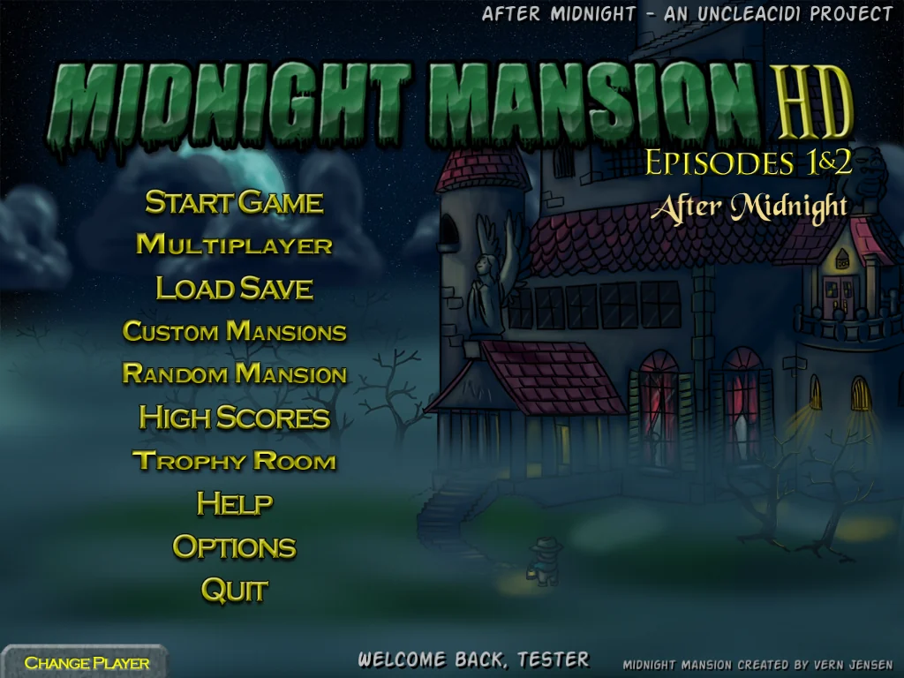<br><sub>The title screen</sub></td>
<td align="center">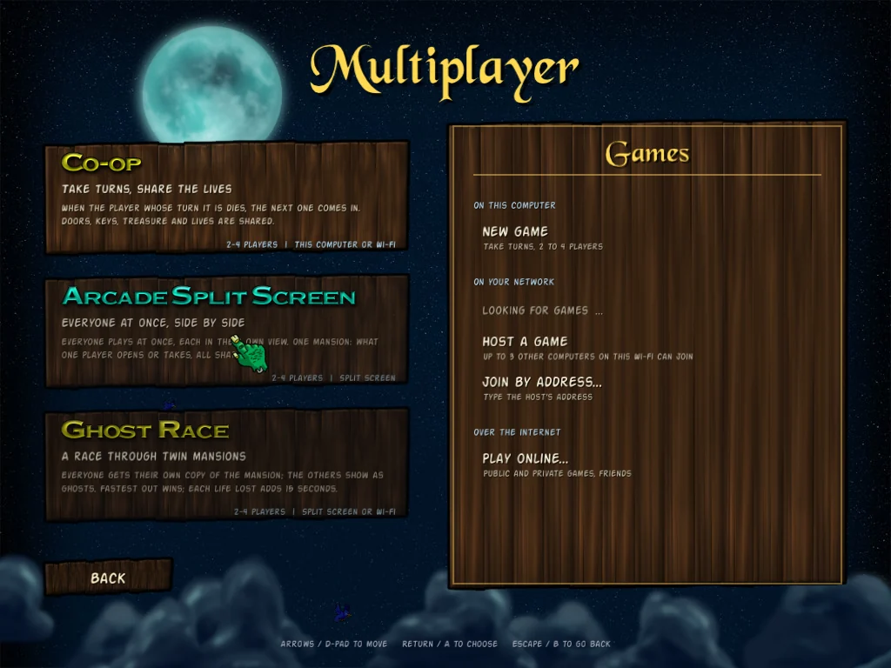<br><sub>Choosing a game</sub></td>
</tr>
<tr>
<td align="center">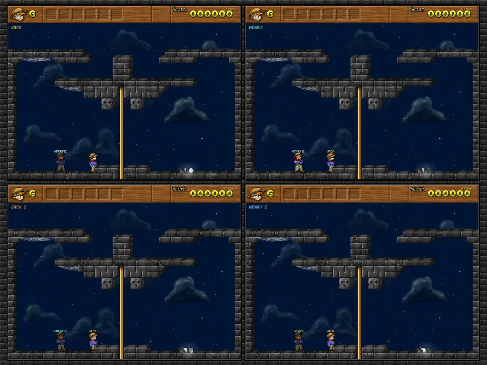<br><sub>Arcade Split Screen with four players</sub></td>
<td align="center">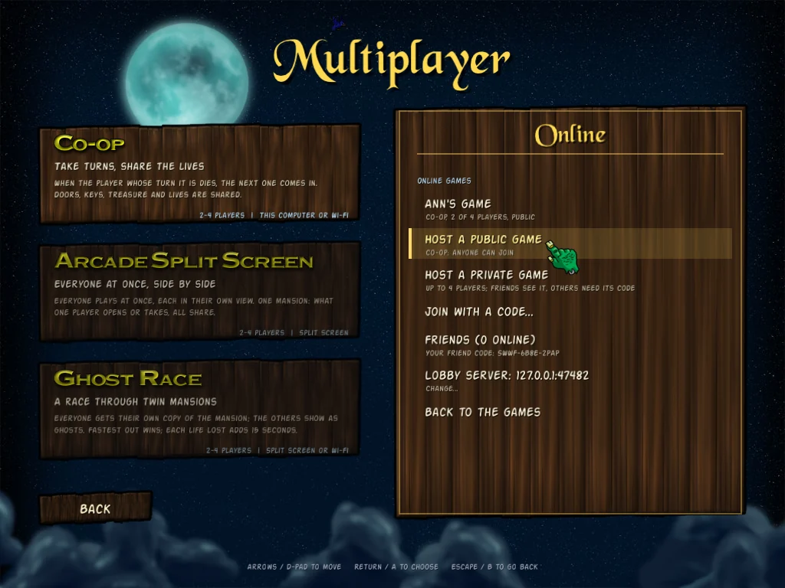<br><sub>Online: public games, friends and codes</sub></td>
</tr>
<tr>
<td align="center">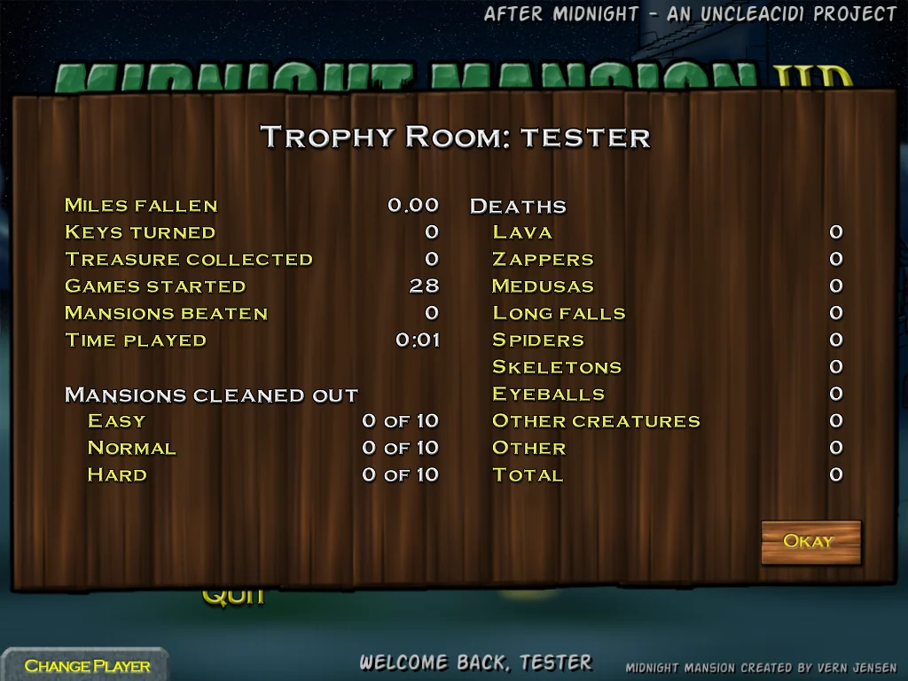<br><sub>The Trophy Room</sub></td>
<td align="center">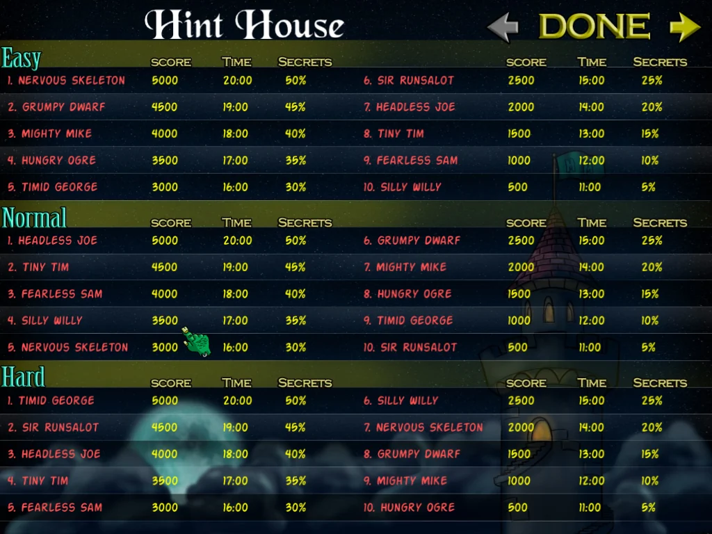<br><sub>High scores, headed in Black Chancery as originally intended</sub></td>
</tr>
</table>

<p align="center">
  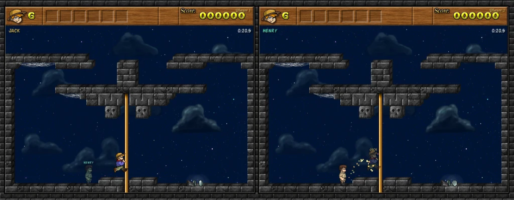<br>
  <sub>Ghost Race: Henry is a ghost in Jack's view (left), and Jack leaves gold dust in Henry's (right)</sub>
</p>

<p align="center">
  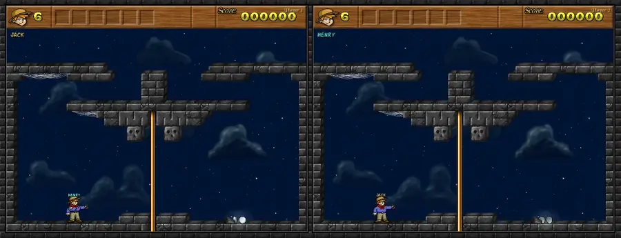<br>
  <sub>Two players in Arcade Split Screen, framed in the mansion's own brick</sub>
</p>

## Getting started

The original game data (the `Game Data` folder) is in this repository under
`original/Midnight Mansion HD.app/Contents/Resources/`.

### macOS (Apple Silicon or Intel)

```sh
xcode-select --install          # once
brew install cmake sdl2         # once, with Homebrew (https://brew.sh)

cmake -B build -DCMAKE_BUILD_TYPE=Release
cmake --build build -j
open "build/Midnight Mansion HD.app"
```

The app carries the game data and SDL2 inside it, so you can drag it to Applications.

### Linux

```sh
sudo apt install cmake libsdl2-dev
cmake -B build -DCMAKE_BUILD_TYPE=Release
cmake --build build -j
MM_RESOURCES_DIR="$PWD/original/Midnight Mansion HD.app/Contents/Resources" ./build/MidnightMansionHD
```

Saves, profiles and settings live in `~/Library/Application Support/ActionSoft/Midnight Mansion/`
on macOS, and in `~/.local/share/ActionSoft/Midnight Mansion/` on Linux. More in
**[docs/BUILDING.md](docs/BUILDING.md)**.

### PS3

*After Midnight* runs on a PS3 with custom firmware (it was made and tested on a PS3 Slim with
Evilnat's CFW) and in the [RPCS3](https://rpcs3.net) emulator. Everything is there: all the
mansions, split screen for up to four controllers, and LAN and online play with the Mac and
Linux versions.

1. **Get the package.** On GitHub, open the **Actions** tab, then the newest **Build** run with
   a green check, and download **After-Midnight-PS3-…** under **Artifacts**. Inside the `.zip`
   is `After-Midnight-1.2-PS3.pkg`.
2. **On a PS3:** copy the `.pkg` to the top of a FAT32 USB flash drive, plug it in, and choose
   **Game → Package Manager → Install Package Files → Standard** on the XMB (or install it with
   multiMAN). **After Midnight** appears in the Game column.
3. **In RPCS3:** **File → Install Packages/Raps/Edats**. For network play set
   **Configuration → Network → Network Status** to **Connected**.

Leave the flash drive in while playing: the game writes its log there
(`After Midnight log.txt`), and plays any custom mansions you put in a folder named
`Midnight Mansion HD Custom Mansions` at its top. On an older TV that cuts off the edges, turn
on **Options → Extras → Picture size** (press Cross until the edges show), and **Larger text** for small print. Saves live in the game's own folder
(`/dev_hdd0/game/AMHD00001/USRDIR/Saves/`). Everything else, including building the package
yourself, is in **[docs/PS3.md](docs/PS3.md)**.

## Controls

| | Keyboard | Controller | PS3 |
|---|---|---|---|
| Walk / climb | Arrow keys (or keypad 4 6 8 2) | Stick or d-pad | Stick or d-pad |
| Jump | Space (keypad 7 / 9 to jump left / right) | A | Cross |
| Action: levers, signs | Return | X or B | Square or Circle |
| Map | M | Y or Back | Triangle or Select |
| Pause | Escape | Start | Start |
| Chat (games on several computers) | T | |

In menus, A (Cross) chooses and B (Circle) goes back; any button closes a sign.
In split screen, a second keyboard player uses **W A S D**, **F** to jump, **G** for action
and **Tab** for the map. All keys can be changed under **Options → Controls**, and the
controller's buttons under **Options → Controls → Controllers...**, which also picks the
controller that runs the menus.

## Playing together

From the title screen, choose **Multiplayer**, then a game type:

| | One computer | Local network | Online |
|---|:---:|:---:|:---:|
| **Co-op**: take turns, share the lives | ✅ | ✅ | ✅ |
| **Arcade Split Screen**: everyone at once, one mansion | ✅ | ✅ | ✅ |
| **Ghost Race**: twin mansions, fastest out wins | ✅ | ✅ | ✅ |

- **One computer:** **Add a player**, choose their controls (the keyboard or a controller) and
  their profile, then choose a mansion.
- **Local network:** one computer hosts and the others find the game in their list (or use
  **Join by address**).
- **Online:** **Play online...** lists public games and your friends' private ones. Host a
  public game, host a private one (friends see it, anyone else needs its code, such as
  `RAVEN-4821`), or join with a code.

Each host picks the mansion, and every computer needs it: the 89 bundled custom mansions work
everywhere. Details are in [docs/EXTRAS.md](docs/EXTRAS.md#multiplayer).

## The lobby server

Online play goes through a tiny lobby server: one Python file with no dependencies, which runs
comfortably on a free cloud instance. Both computers connect *out* to it, so nobody has to
touch their router. It introduces players, then quietly carries their game.

<p align="center">
  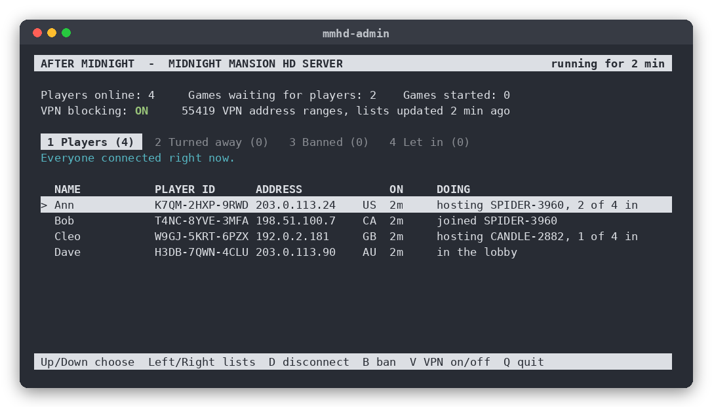<br>
  <sub><code>mmhd-admin</code>: who's on, what they're doing, and one-key disconnect, ban and VPN blocking (sample data)</sub>
</p>

- **Runs 24/7** as a service that restarts itself and survives reboots.
- **Looks after itself**: it ignores junk traffic, limits connection floods, and blocks VPNs
  and proxies (and that blocking can be turned off).
- **A plain control screen**, `mmhd-admin`: disconnect, ban (by address and by player ID),
  unban, and let someone in despite the VPN check.
- **Desktop shortcuts for Mac**: one double-click opens the control screen, and another
  updates the server.

Setting one up, on Oracle Cloud's free tier or any Linux machine, takes a few minutes:
**[docs/ONLINE.md](docs/ONLINE.md)**.

## How it was made

**This entire project was made possible using Claude Opus 5.5, and it was strictly vibe coded.**
Every line of code in *After Midnight* was written by Claude Opus 5.5 through
[Claude Code](https://claude.com/claude-code). That covers the source reconstruction, the
modern port, the multiplayer, the networking, the lobby server and its tools. Each was directed
in plain conversation by a player who loves this game, tested by playing it, and refined one
note at a time.

How the reconstruction works:

1. **Reading the original.** The 2011 Mac executable still carries its symbols: all of its
   ~2,000 functions and ~1,000 globals have their original names. Ghidra's decompiled output
   for each original source file is kept read-only in [`reference/`](reference/).
2. **Rewriting it as real C.** Each original source file was rebuilt as readable C99 that
   behaves the same. This is a *functional* reconstruction, not a byte-for-byte one. The plan
   and the method are in [docs/PLAN.md](docs/PLAN.md).
3. **Bringing it to today.** Rendering goes through SDL2 and OpenGL, on a fork of the
   SpriteWorld X engine the original was built on. It runs natively on Apple Silicon.
4. **Building new rooms.** The multiplayer, online play, controllers, options and Trophy Room
   were all added on top. With them switched off, the game plays as it always did.

About 47,000 lines of C, and a clean build has no warnings.

## Project layout

```
src/game/        the game: the reconstructed original, plus everything After Midnight adds (MM*.c)
src/swx/         SpriteWorld X, the sprite and rendering engine, ported to SDL2 + OpenGL
src/ps3/         the PS3 version: OpenGL on the RSX, controllers, sound, files, network
server/          the lobby server, mmhd-admin, the installer, and Mac desktop shortcuts
extras/          new art and sounds, and the 89 bundled custom mansions
original/        the original Mac app bundle and its game data
reference/       Ghidra output and symbol maps of the original (read-only)
tools/           decompiling and art-generating scripts
docs/            building, extras, online play, the reconstruction plan, images
platform/macos/  the app bundle's Info.plist and library bundling
platform/ps3/    the PS3 package: Makefile, shaders' build, XMB art and sound, mansion packing
third_party/     stb, dr_mp3, and SpriteWorld X upstream
```

## Credits

<table>
<tr><td><b>Vern Jensen</b></td><td>Creator of <i>Midnight Mansion</i> and <i>Midnight Mansion HD</i>. The original game, its design, and its mansions are his work. Published by ActionSoft.</td></tr>
<tr><td><b>Thom Yorke</b> (<a href="https://github.com/UncleAcid1">@UncleAcid1</a>)</td><td>After Midnight's creator and director: the vision, every design note, testing, additional art, the PS3 version's XMB icon, background and sound, and running the lobby server.</td></tr>
<tr><td><b>Claude Opus 5.5</b> (Anthropic)</td><td>All of the code, via Claude Code.</td></tr>
<tr><td><b>The Midnight Mansion community</b></td><td>The 89 custom mansions bundled in <code>extras/Custom Mansions</code>, each by its own author.</td></tr>
<tr><td><b>SpriteWorld X</b></td><td>Michael Cabral, Ben Henke, Justin Van Eaton, David Beck and Anders F Björklund (zlib licence).</td></tr>
<tr><td><b>stb</b> and <b>dr_mp3</b></td><td>Sean Barrett (stb_image, stb_truetype, stb_vorbis) and David Reid (dr_mp3), both public domain or MIT.</td></tr>
<tr><td><b>SDL2</b></td><td>The Simple DirectMedia Layer project (zlib licence).</td></tr>
<tr><td><b>PSL1GHT</b> and <b>ps3dev</b></td><td>The open-source PS3 SDK and toolchain the PS3 version is built with (MIT licence), and the SDL2 port for it.</td></tr>
</table>

## Legal

*After Midnight* is an unofficial fan project, made out of admiration for the original. It is
not affiliated with or endorsed by Vern Jensen or ActionSoft. *Midnight Mansion* and
*Midnight Mansion HD*, and the original game's art, sound, music, mansions and fonts (in
`original/`), remain the property of their owners. Plate Gothic (`tools/fonts`) is a
commercial typeface, used only to render the new menu-button art.

<p align="center"><br><i>"First time? Go to the Hint House first!"</i><br><br></p>
